# Tiny Map

**Vẽ một khu trên bản đồ → dựng thành mô hình thành phố 3D low‑poly** ngay trong trình duyệt, từ dữ liệu mở OpenStreetMap. Có chu kỳ ngày/đêm theo vị trí mặt trời thật, cửa sổ sáng đèn về đêm, xe cộ và tàu điện chạy, lớp giao thông, thời tiết thực tế, chế độ pixel và xuất file `.glb`.

> **Hai phiên bản (từ v0.0.5):**
> - [`/`](https://danny-exnodes.github.io/3d-map/): **Google 3D**, gồm mô hình Photorealistic 3D Tiles, bản đồ và giao thông Google, địa chỉ Google. Cần API key Google Maps Platform của bạn (Map Tiles API, Maps JavaScript API, Geocoding API). Key chỉ lưu trong trình duyệt.
> - [`/openstreetmap/`](https://danny-exnodes.github.io/3d-map/openstreetmap/): **bản dựng từ dữ liệu mở** (OSM, Overture, Google Open Buildings 2.5D), không cần key. Mọi tính năng bên dưới thuộc bản này.

*Draw a rectangle on a map and get a stylised 3D diorama of that neighbourhood, built client-side from OpenStreetMap data.*

| Chọn vùng | Ban ngày | Ban đêm |
| --- | --- | --- |
| 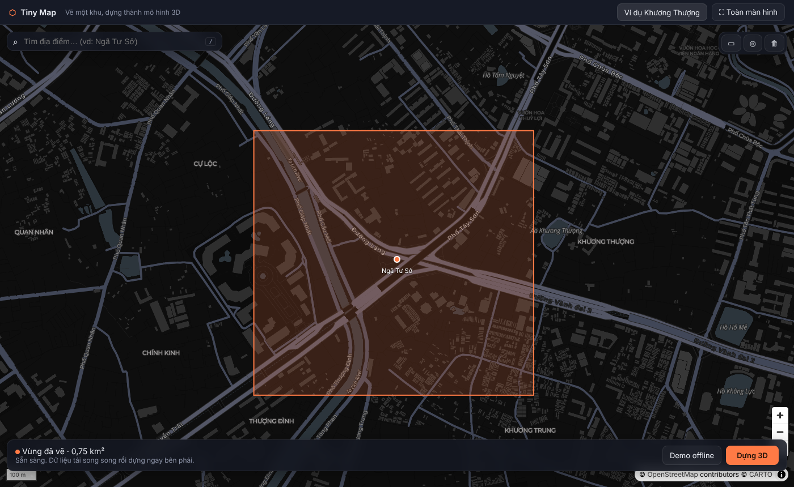 | 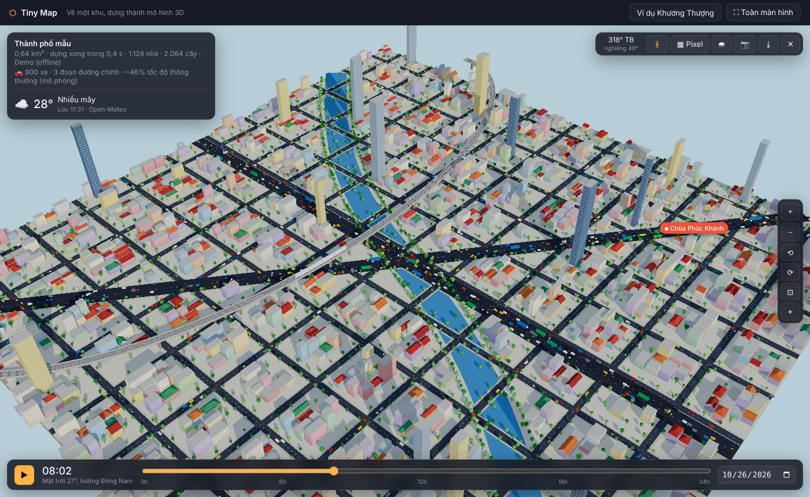 | 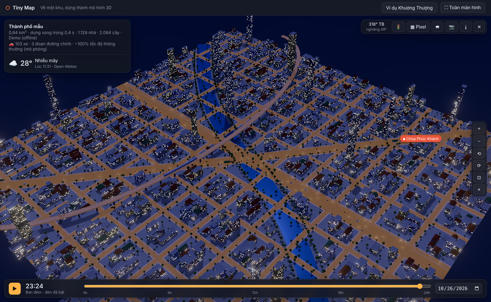 |

## Tính năng

**Chọn vùng**
- Mở app sẽ tự lấy vị trí hiện tại. Không lấy được thì về mặc định Én Nam – 101 Châu Thị Hoá (TP.HCM). Nút 📍 để lấy lại vị trí.
- Tìm địa điểm (Nominatim), kéo chuột vẽ hình chữ nhật, hoặc chọn nhanh 800 m quanh tâm bản đồ. Vùng được lưu vào URL (`#bbox=…`) để chia sẻ.

**Dữ liệu** (xem [Nguồn dữ liệu](#nguồn-dữ-liệu))
- Footprint nhà gộp từ **OpenStreetMap** và **Overture Maps** (Google/Microsoft ML buildings). Ở nhiều khu của VN, Overture có nhiều nhà hơn OSM hàng chục lần.
- **Chiều cao** ưu tiên theo thứ tự: tag OSM > **Google Open Buildings 2.5D** (trung vị trong footprint) > số tầng Overture > ước lượng theo hình dạng footprint.
- Mỗi nhà ghi lại nguồn của footprint và chiều cao. Nút 📏 tô màu nhà theo nguồn chiều cao.
- Ngoài nhà còn có đường theo cấp & số làn, cầu vượt, đường sắt trên cao, sông hồ, công viên, cây, địa điểm nổi bật.

**Dựng 3D** (Three.js, chạy trong Web Worker)
- Mái dốc, mái chóp, mái chùa hai tầng và mái vòm được đặt theo hình chữ nhật bao nhỏ nhất của footprint. Nhà xưởng có mái tôn thấp. Đọc được `building:part`, `roof:*`, `building:colour/material` (Simple 3D Buildings).
- Kiến trúc mẫu Việt Nam:
  - nhà ống/shophouse có ban công ở mặt tiền giáp đường, tum thang và bồn nước inox trên sân thượng;
  - chung cư/cao ốc có khối đế và tháp lùi vào;
  - mặt kính, gạch, kim loại thể hiện bằng shader.
- Cửa sổ sinh bằng shader (không cần texture). Có vỉa hè, vạch kẻ đường, trụ cầu, hàng cây ven đường, đèn đường.
- **Bấm vào một nhà** để xem tên, loại, số tầng, chiều cao, nguồn dữ liệu, kèm link sửa hoặc vẽ thêm trên OpenStreetMap.

**Hiển thị**
- Ba chế độ xem **Có màu / Đơn sắc / Siêu thực**. Lựa chọn được ghi nhớ, đặt được qua URL `?style=mono|real`.
  - Đơn sắc theo phong cách mô hình kiến trúc, đèn đêm vẫn giữ màu ấm.
  - **Siêu thực** (#19) dùng vật liệu PBR sinh hoàn toàn bằng shader, không tải texture nên chạy được offline:
    - mặt tiền: vữa loang, vệt mưa, gờ sàn, cửa sổ có khung và bậu, kính phản chiếu trời, cục lạnh, cửa cuốn và bảng hiệu tầng trệt, tường kính, gạch, ốp kim loại;
    - mái: mái bằng bê tông có vết ố, mái tôn sóng có gỉ, mái ngói;
    - mặt đất: đường nhựa có vá và ướt khi mưa, vỉa hè lát gạch, cỏ;
    - sông hồ có sóng động và phản chiếu bầu trời;
    - tán cây nhiều khối;
    - bầu trời khí quyển có mây, chiếu sáng môi trường, ambient occlusion (tự tắt khi máy yếu), bóng mềm.
- Chế độ pixel.
- Thanh thời gian 24h + chọn ngày. Mặt trời đặt đúng vị trí thiên văn theo toạ độ. Ban đêm có ánh trăng, cửa sổ và đèn xe sáng, bloom.
- **Giao thông (mô phỏng)**: xe máy, ô tô, xe buýt chạy theo làn bên phải, mật độ đổi theo giờ cao điểm. Lớp 🚦 tô màu tốc độ. Có tàu chạy trên ray.
- **Thời tiết thực** từ Open‑Meteo: nhiệt độ, mây, mưa.

**Hiệu năng**
- Dữ liệu tải và mô hình dựng trong Web Worker, main thread không bị đơ.
- Bộ nhớ đệm IndexedDB (OSM 7 ngày, Overture 30 ngày, thời tiết 15 phút).
- Tiến độ hiện theo số byte tải thật. Có nút huỷ.
- Bóng đổ chỉ render lại khi cần. Pixel ratio tự hạ khi FPS thấp. Chi tiết nhỏ chỉ hiện khi zoom gần (LOD).
- Benchmark tự động trong CI.

**Mới trong v0.0.5**
- Không còn nhà chồng lên nhau: footprint được xếp theo độ tin cậy (OSM, rồi Overture, rồi nhà suy ra). Nhà nào phần lớn bị đè thì thu nhỏ hoặc bỏ.
- Bó vỉa nổi ở hai mép đường. Mặt nước xanh hơn (Siêu thực). Xe vào hoặc ra ở nút giao và mép mô hình, không tự hiện giữa đường.
- Chọn vùng: kéo góc thì các góc khác chạy theo, kéo bên trong vùng để dời vùng.
- Ghim vị trí hiện tại có hiệu ứng trên bản 3D. Thẻ toà nhà gọn hơn, địa chỉ mở thẳng Google Maps.
- Bản Google 3D ở trang gốc. Bản này chuyển sang `/openstreetmap/`.

**Mới trong v0.0.4**
- Bấm vào toà nhà hiện địa chỉ (thẻ OSM, nếu không có thì tra ngược Nominatim, có cache).
- Tường và mái có vết bẩn, vệt mưa, AO chân tường, bớt "nhựa".
- Xe có kính, lốp; xe máy có người lái đội mũ; người đi bộ có tay chân màu da.
- Space view chuyển cảnh liền mạch: globe dựng sẵn, bắt đầu đúng góc camera 3D, mô hình hoà dần vào ảnh vệ tinh Sentinel-2.
- 🚦 Lấy giao thông thực từ Google (Routes API, key của bạn, chỉ lưu trong trình duyệt).

**Mới trong v0.0.3**
- **Giao diện:**
  - desktop chia đôi Bản đồ | 3D, thanh chia kéo được (#23);
  - điện thoại có thanh tab, nút to, thẻ thông tin thu gọn;
  - vẽ vùng bằng Shift+kéo hoặc chạm; kéo góc để đổi kích thước, kéo tâm để di chuyển.
- **🌍 Space view (#24):** bay lên vũ trụ, xoay trái đất, rồi rơi về đúng vị trí cũ.
- **Hiệu năng (#22):**
  - nhà phổ thông dùng chung 4 hình mẫu (instancing), chỉ công trình công cộng, tôn giáo và toà lớn dựng chính xác;
  - bộ nhớ hình học khối nhà giảm khoảng 83%;
  - kéo thanh thời gian không còn giật/chớp.
- **Ban đêm (#25):** cửa sổ sáng theo giờ, có vũng sáng đèn đường (cả trong hẻm).
- **Cầu và hầm (#25):** cầu vượt có thành cầu và xà trụ; hầm chui có dốc, tường chắn, cửa hầm.
- **Giao thông (#26):**
  - có xe máy (~76%), ô tô, buýt, xe tải, xe đạp và người đi bộ;
  - mật độ theo cấp đường, giờ, và mức gần chợ/trường/bệnh viện; tốc độ theo tỉ lệ lưu lượng/năng lực;
  - lớp 🚦 tô theo mô hình này.

| Chia đôi màn hình | Space view | Điện thoại |
| --- | --- | --- |
| 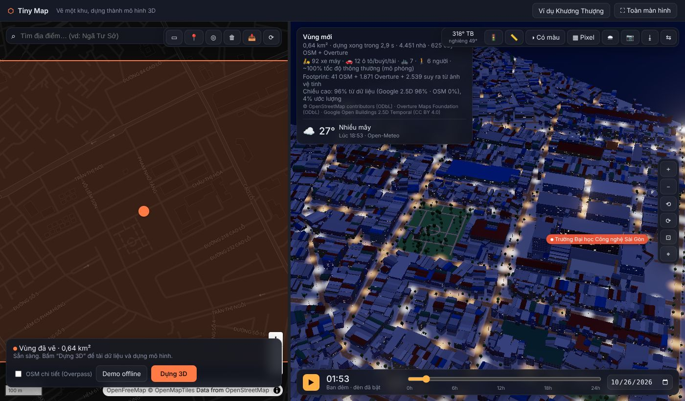 | 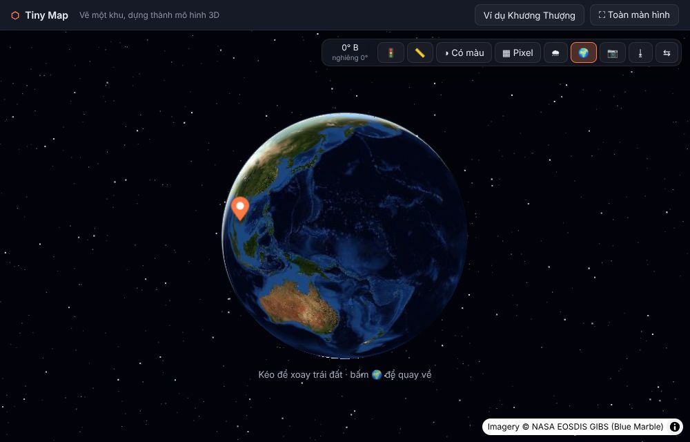 | 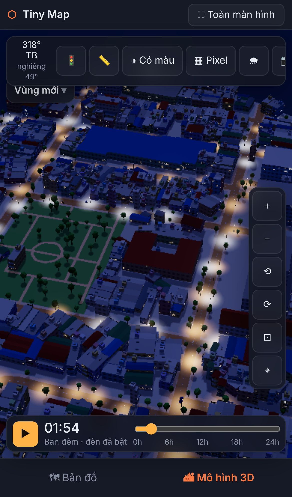 |

| Đèn đường | Xe máy, người đi bộ | Hầm chui Kim Liên |
| --- | --- | --- |
| 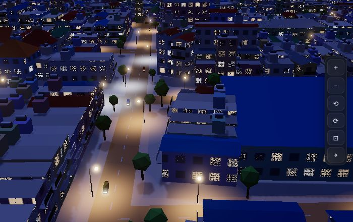 | 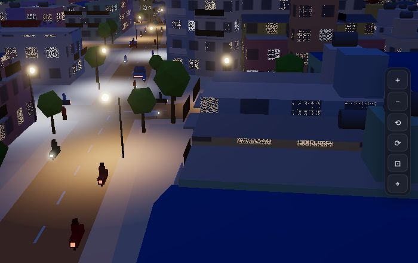 | 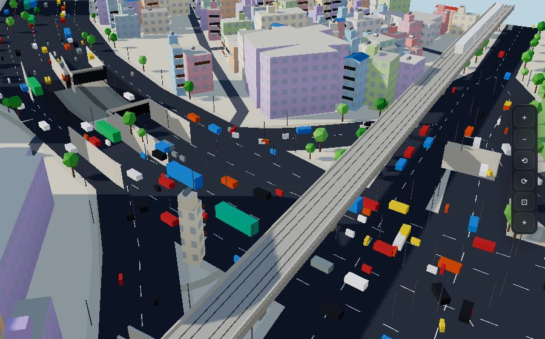 |

**Bản đồ offline theo phường** (#18)
- Nút 📥 trên bản đồ mở danh sách phường/xã của **TP.HCM** (167 đơn vị, 113 phường) và **Hà Nội** (130 đơn vị, 51 phường), theo địa giới sau sắp xếp 2025. Tìm không dấu cũng được (vd: `chanh hung`).
- Chọn phường để xem ranh giới, rồi bấm “Tải về máy”. Gói gồm:
  - nhà và đường Overture;
  - địa điểm OpenFreeMap;
  - bản đồ nền (tile, font, sprite);
  - lưới chiều cao.

  Một phường khoảng 30–40 MB.
- Khi mất mạng, app vẫn mở được (service worker): bản đồ nền hiện đầy đủ, dựng 3D được mọi khu trong phường đã tải. Dữ liệu offline được ghim, không bị xoá khi dọn bộ nhớ đệm. Phường dùng chung ô dữ liệu vẫn xoá riêng được.

**Xuất**: ảnh PNG, mô hình `.glb` (theo chế độ màu đang chọn).

**Demo offline**: thêm `?demo` vào URL để dựng thành phố sinh ngẫu nhiên.

| Ngã Tư Sở (OSM + Overture + Google 2.5D) | Nguồn chiều cao 📏 | Đơn sắc |
| --- | --- | --- |
| 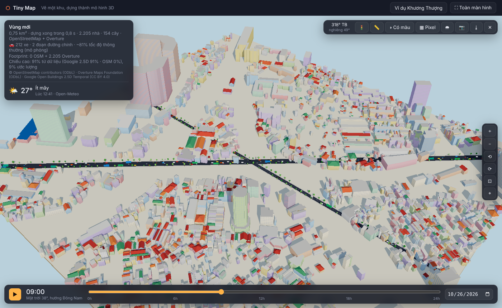 | 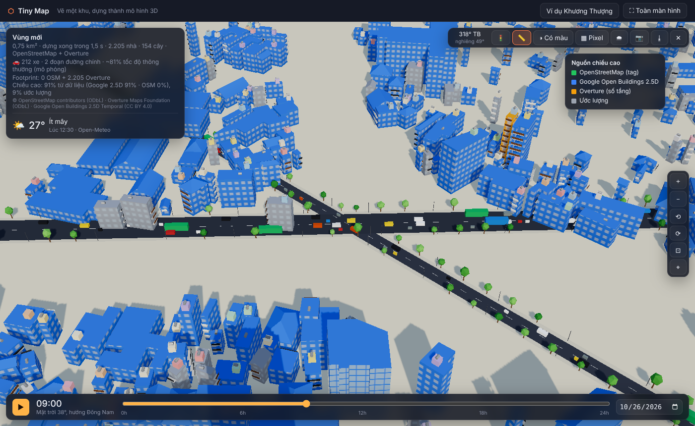 | 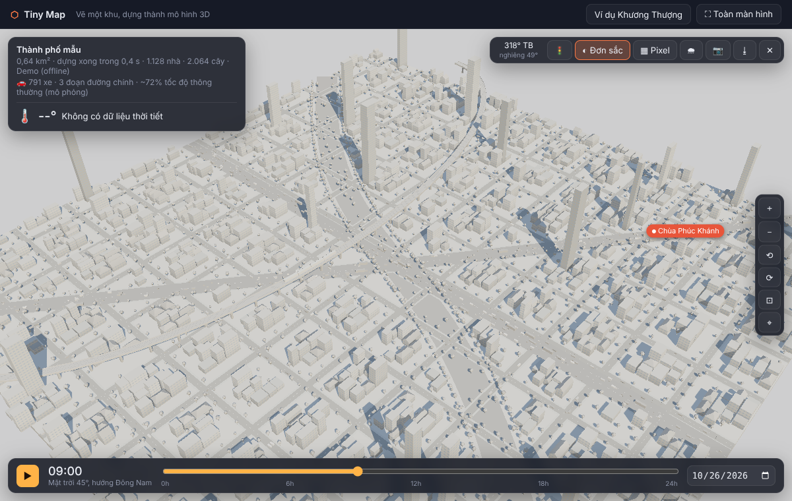 |

| Có màu | Siêu thực | Siêu thực – cận cảnh |
| --- | --- | --- |
| 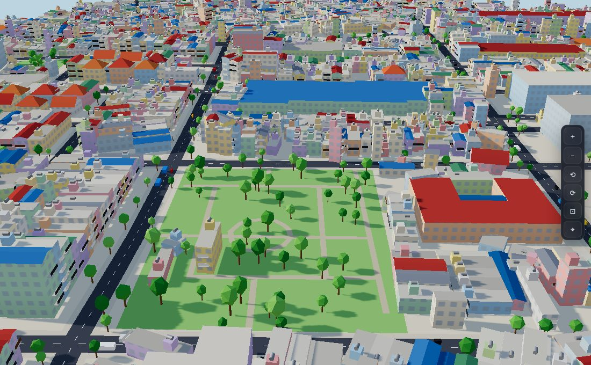 | 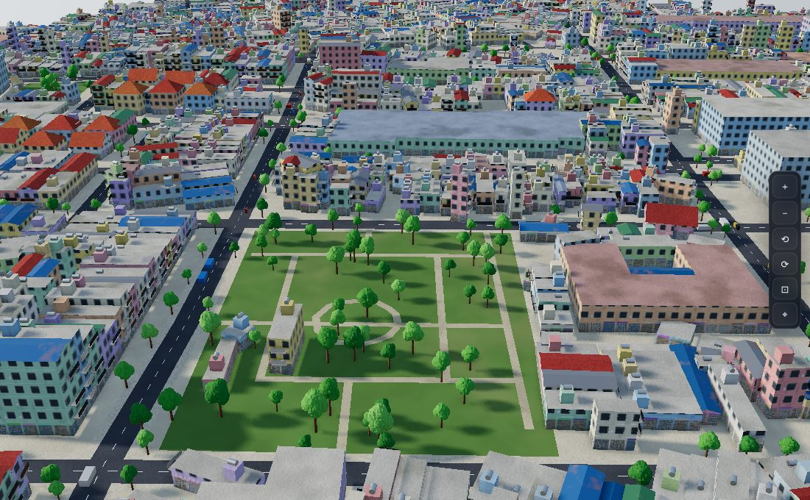 | 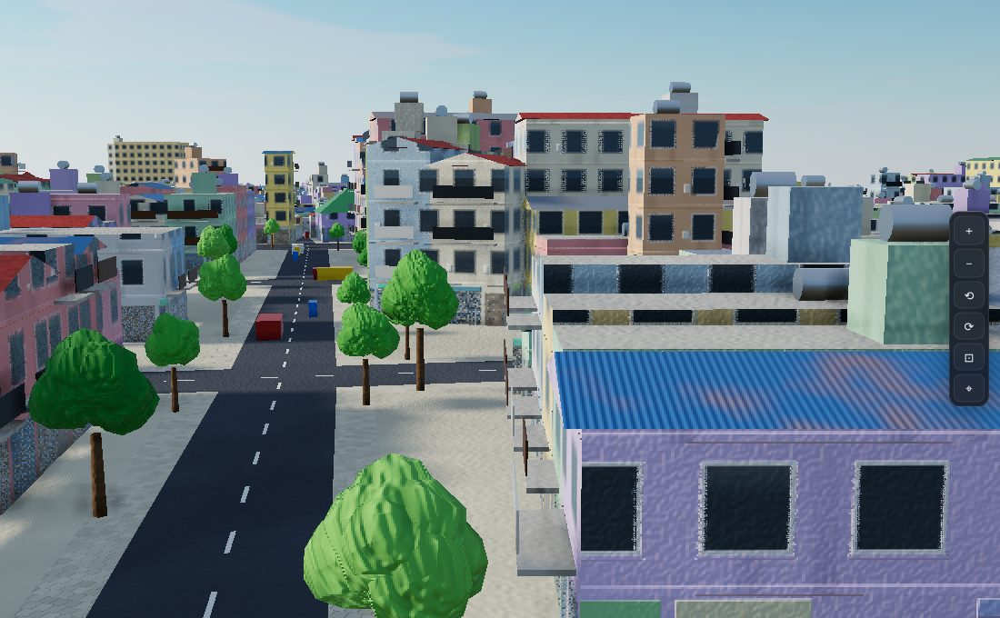 |

| Siêu thực – sông, cầu cạn | Siêu thực – ban đêm | |
| --- | --- | --- |
| 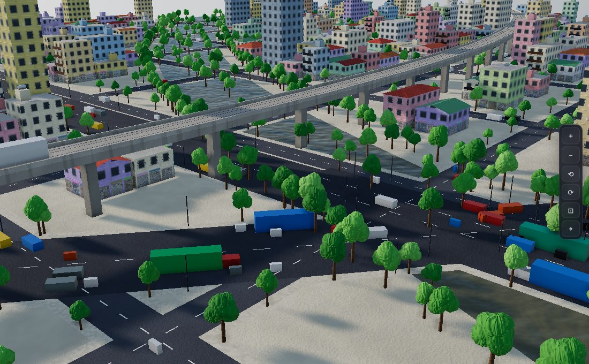 | 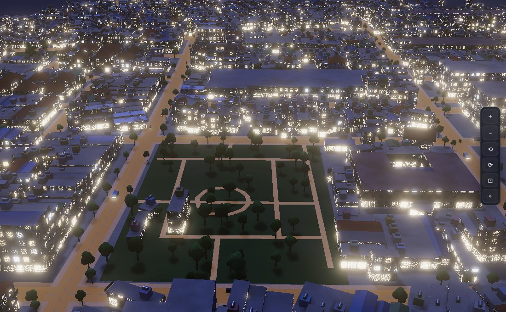 | |

| Én Nam – Q.8, TP.HCM | Thông tin toà nhà | Ban đêm |
| --- | --- | --- |
| 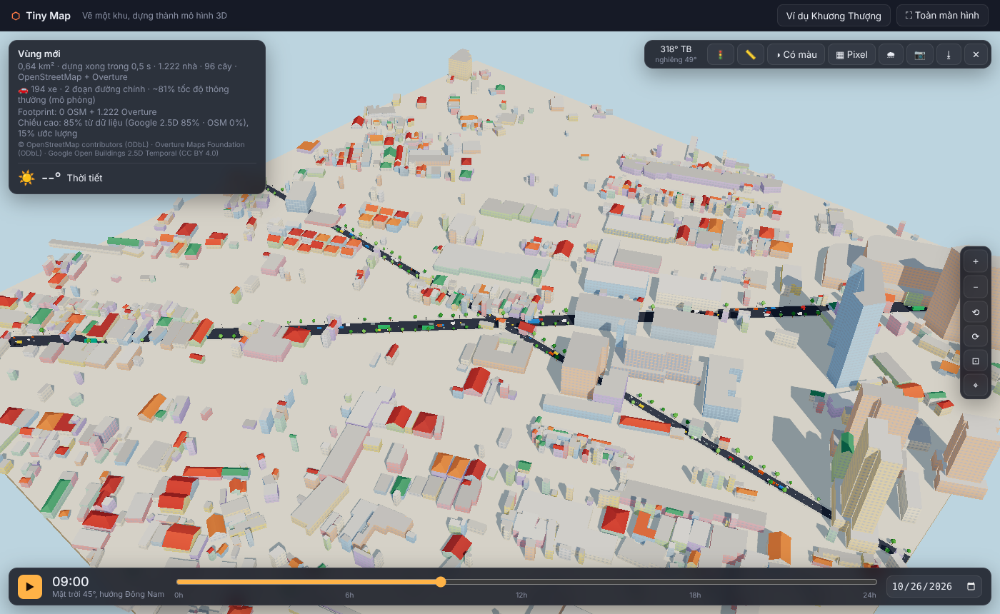 | 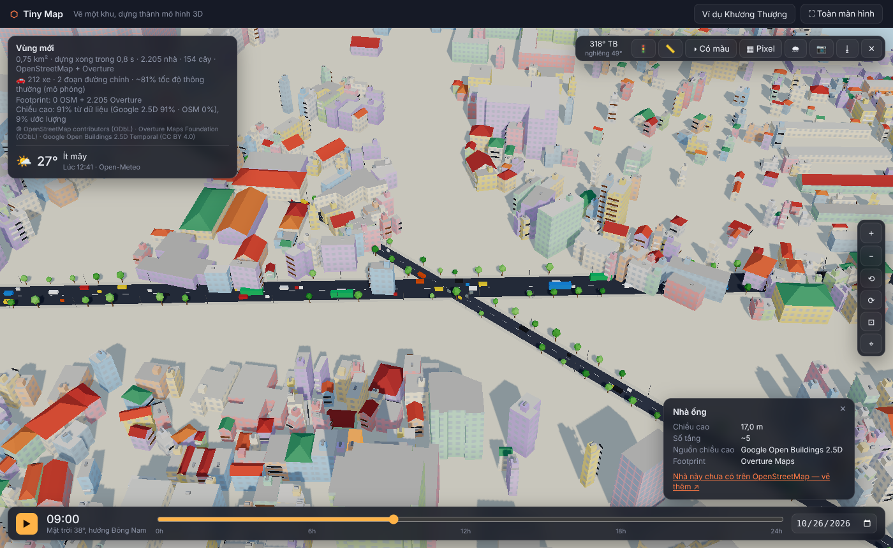 |  |

## Chạy thử

```bash
npm install
npm run dev        # http://localhost:5173 — có thêm /api/heights tính chiều cao cho mọi vùng ở VN
npm test           # unit test
npm run build      # bản tĩnh trong dist/
npm run bench      # benchmark (cần `npm run preview` đang chạy ở cổng 4173)
```

Yêu cầu Node 22.18+ (CLI chiều cao chạy thẳng file `.ts`) và trình duyệt hỗ trợ WebGL2.

## Nguồn dữ liệu

| Nguồn | Dùng cho | Cách truy cập | Giấy phép |
| --- | --- | --- | --- |
| [OpenStreetMap](https://www.openstreetmap.org/) qua Overture (mặc định) hoặc Overpass (tuỳ chọn) | nhà, đường, sông, cây… | PMTiles / Overpass, cache IndexedDB | ODbL |
| [Overture Maps](https://docs.overturemaps.org/guides/buildings) `buildings.pmtiles` | bù footprint | PMTiles (range request, CORS) | ODbL |
| [Google Open Buildings 2.5D Temporal](https://sites.research.google/gr/open-buildings/temporal/) | chiều cao nhà | GeoTIFF công khai, **không có CORS** → tiền xử lý | CC BY 4.0 |
| [OpenFreeMap](https://openfreemap.org/) | bản đồ nền, địa điểm | vector tiles (CORS) | ODbL (dữ liệu OSM) |
| [Overture divisions](https://docs.overturemaps.org/guides/divisions/) | ranh giới phường/xã | `tools/wards.mjs` → `public/wards/` | ODbL |
| [Google Map Tiles API](https://developers.google.com/maps/documentation/tile) (Photorealistic 3D Tiles, 2D, giao thông) + Geocoding | bản Google 3D | REST/JS API, key của người dùng | Google Maps Platform ToS |
| [EOX Sentinel-2 cloudless 2016](https://s2maps.eu) | ảnh vệ tinh gần (Space view) | WMTS | CC BY 4.0 |
| [Google Routes API](https://developers.google.com/maps/documentation/routes) | giao thông thực (tuỳ chọn) | REST, key của người dùng | Google Maps Platform ToS |
| [NASA GIBS](https://earthdata.nasa.gov/gibs) Blue Marble | ảnh trái đất (Space view) | WMTS (CORS) | public domain |
| [Open‑Meteo](https://open-meteo.com/) | thời tiết | trình duyệt | CC BY 4.0 |

### Lưới chiều cao Google 2.5D

GeoTIFF của Google không cho trình duyệt đọc trực tiếp vì không có CORS. Vì vậy chiều cao được trích sẵn thành lưới 2 m (`uint16`, đơn vị dm):

```bash
# Sinh lưới cho một vùng (chỉ phủ Việt Nam — chỉ mục tile ở tools/data/)
npm run heights -- --id hoankiem --name "Hồ Hoàn Kiếm" --bbox 21.024,105.848,21.034,105.858
```

File được ghi vào `public/heights/` và tự thêm vào `index.json`. Repo kèm sẵn lưới cho **Ngã Tư Sở** và **Én Nam**.

**Ô chiều cao z14 cho mọi phường TP.HCM và Hà Nội.** `npm run heights:tiles` sinh ~590 ô (lưới 2 m, theo lưới tile z14) vào `public/heights/z14/`. Dung lượng khoảng 100 MB nên không commit; CI sinh ô khi deploy và cache giữa các lần chạy. App tự ghép các ô cho vùng đã chọn, nên bản tĩnh trên GitHub Pages cũng có chiều cao thật và suy ra được nhà từ ảnh vệ tinh.

```bash
npm run heights:tiles -- --only 13046-7699,13046-7700   # vài ô để thử ở máy
npm run wards                                            # dựng lại public/wards/{hcm,hn}.json từ Overture divisions
```

Cách app tìm lưới chiều cao cho một vùng:
- `npm run dev`: endpoint `/api/heights` tính lưới cho vùng bất kỳ.
- Bản tĩnh: đặt `VITE_HEIGHTS_API=https://…/api/heights` trỏ tới một proxy cùng API (#4).
- Bản tĩnh: ghép từ ô z14 `heights/z14/` (khi vùng nằm trong các phường TP.HCM/Hà Nội).
- Không có lưới: dùng heuristic theo hình dạng footprint.

## Kiến trúc

```
src/
  main.ts                 # UI: chọn vùng → tải → dựng → điều khiển
  config.ts               # vị trí mặc định, vùng ví dụ
  services/location.ts    # vị trí hiện tại + fallback
  ui/MapView.ts           # bản đồ 2D MapLibre + vẽ hình chữ nhật
  data/loader.ts          # pipeline: OSM ∥ Overture ∥ chiều cao → ghép
  data/osm.ts             # Overpass (stream, rate limit) + parser
  data/overture.ts        # Overture PMTiles → footprint
  data/heights.ts         # lưới chiều cao Google 2.5D
  data/enrich.ts          # ghép footprint, gán chiều cao, thống kê nguồn
  data/buildings.ts       # tag → Building: kiến trúc mẫu, heuristic, kiểu mái
  data/cache.ts           # IndexedDB (TTL + LRU, ghim cho gói offline)
  data/offline.ts         # gói offline theo phường (#18)
  worker/                 # Web Worker: tải dữ liệu + dựng hình, truyền buffer
  scene/CityScene.ts      # renderer, camera, ánh sáng, bloom, chọn nhà, xuất GLB
  scene/buildings.ts      # tường + mái gộp 1 mesh, shader cửa sổ/vật liệu/chọn
  scene/roofs.ts          # OBB, mái dốc/chóp/vòm/chùa
  scene/details.ts        # ban công, tum thang, bồn nước (instanced, LOD)
  scene/colorMode.ts      # Có màu / Đơn sắc
  scene/realistic.ts      # Siêu thực: vật liệu PBR thủ tục, bầu trời, nước, cây
  scene/prototypes.ts     # nhà mẫu dùng chung (instancing)
  scene/trafficModel.ts   # mô hình lưu lượng, tỉ lệ phương tiện
  scene/nightLights.ts    # tỉ lệ cửa sổ sáng, vũng đèn đường
  ui/SpaceView.ts         # Space view (globe)
  scene/roads.ts …        # đường, cầu, ray; landscape.ts; traffic.ts; sun.ts
tools/
  gob-heights.mjs         # CLI trích lưới chiều cao
  height-tiles.mjs        # ô chiều cao z14 cho các phường (CI)
  wards.mjs               # ranh giới phường/xã từ Overture divisions
public/sw.js              # service worker: chạy offline
  gob-index.mjs           # dựng lại chỉ mục tile Google 2.5D cho VN
  overture-spike.mjs      # đo độ phủ Overture tại một điểm
bench/                    # benchmark + ngân sách hiệu năng cho CI
```

## Phiên bản

- [v0.0.5](docs/releases/v0.0.5.md) (2026-10-27): bản Google 3D ở `/`, bản OSM ở `/openstreetmap/`; hết nhà chồng lấn, bó vỉa, xe vào ở nút giao, chọn vùng, ghim vị trí.
- [v0.0.4](docs/releases/v0.0.4.md) (2026-10-27): địa chỉ toà nhà, vật liệu bớt nhựa, xe thật hơn, giao thông Google, Space view liền mạch.
- [v0.0.3](docs/releases/v0.0.3.md) (2026-10-27): hiệu năng (nhà mẫu), chia đôi màn hình, mobile, Space view, ánh sáng đêm, cầu/hầm, giao thông xe máy.
- [v0.0.2](docs/releases/v0.0.2.md) (2026-10-26): mật độ nhà thật, bỏ phụ thuộc Overpass, chế độ Siêu thực, bản đồ offline theo phường.
- [v0.0.1](docs/releases/v0.0.1.md) (2026-10-26): release note kiêm checkpoint (kiến trúc, quy trình, giới hạn, việc tiếp theo).

## Lộ trình

Kế hoạch và thảo luận nằm trong [issue #1](https://github.com/danny-exnodes/3d-map/issues/1). Backlog hiện tại:

- [ ] Proxy CORS để bản tĩnh lấy được chiều cao cho mọi vùng (#4)
- [ ] Lớp so sánh ảnh thực Google Photorealistic 3D Tiles (#6)
- [ ] Dữ liệu giao thông thực (#11)
- [ ] Chia tile + LOD cho vùng lớn, địa hình (DEM), straight skeleton cho mái phức tạp

## Dữ liệu & giấy phép

- Mã nguồn: [MIT](LICENSE).
- Dữ liệu bản đồ © [OpenStreetMap contributors](https://www.openstreetmap.org/copyright) (ODbL). Footprint bổ sung: [Overture Maps Foundation](https://overturemaps.org/) (ODbL). Chiều cao: [Google Open Buildings 2.5D Temporal](https://sites.research.google/gr/open-buildings/temporal/) (CC BY 4.0) — các file trong `public/heights/` là dữ liệu phái sinh, cùng giấy phép CC BY 4.0. Nền bản đồ © [CARTO](https://carto.com/attributions). Thời tiết: [Open‑Meteo](https://open-meteo.com/) (CC BY 4.0).
- App hiển thị ghi công đúng các nguồn đã dùng cho từng vùng.
- Hãy tôn trọng chính sách sử dụng của các dịch vụ công cộng: [Overpass](https://wiki.openstreetmap.org/wiki/Overpass_API#Public_Overpass_API_instances), [Nominatim](https://operations.osmfoundation.org/policies/nominatim/) (≤ 1 request/giây). Khi triển khai lượng truy cập lớn, nên tự host Overpass/Nominatim.
